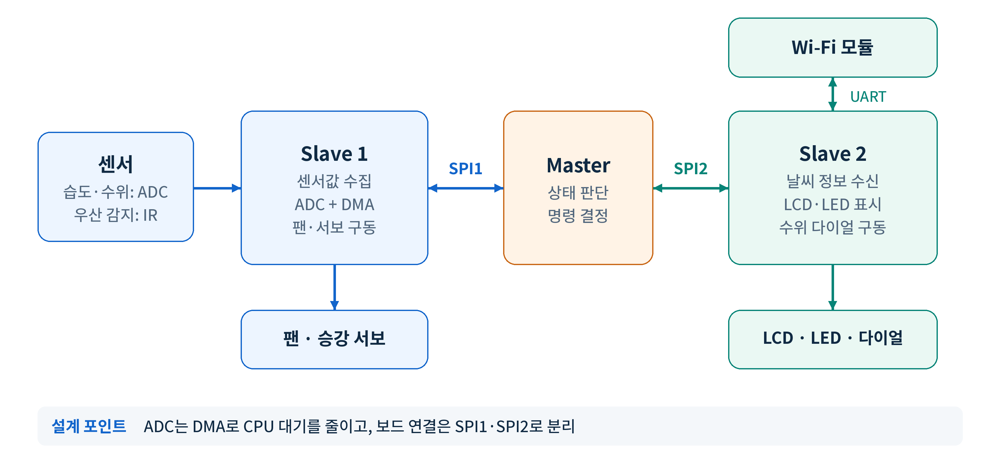
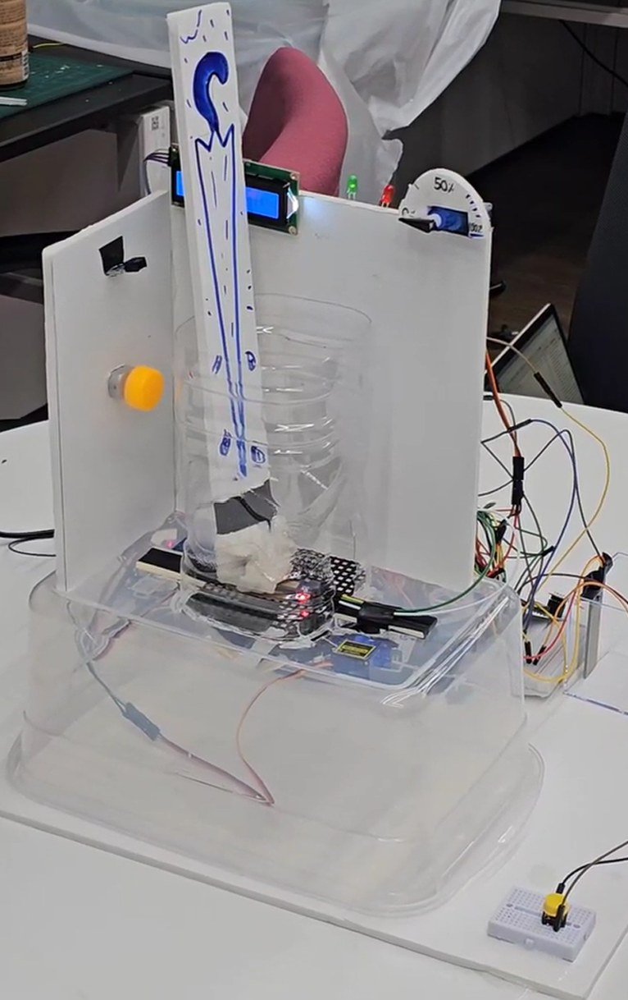

# STM32 3-MCU 센서·구동 분산 제어 시스템

STM32F103 세 개에 **센싱·구동 / 중앙 판단 / 외부 통신·표시**를 나눠 맡기고 SPI로 연결한 스마트 우산꽂이 제어 시스템입니다.
센서 취득부터 팬·서보 구동까지의 핵심 경로(ADC, DMA, SPI, Timer PWM, GPIO)는 레지스터 수준에서 직접 설정했습니다.

| 팀 규모 | 역할 |
|---|---|
| 5인 | 팀장, 센싱·구동 노드와 중앙 판단 노드 담당 |

## 목차

1. [시스템 구성](#1-시스템-구성)
2. [문제와 원인 → 해결 과정 → 결과](#2-문제와-원인--해결-과정--결과)
   - [2.1 ADC 대기로 묶인 CPU: Circular DMA](#21-adc-대기로-묶인-cpu-circular-dma)
   - [2.2 경계값에서 반복 전환되는 날씨 모드: 히스테리시스](#22-경계값에서-반복-전환되는-날씨-모드-히스테리시스)
   - [2.3 상대 보드 무응답 시 멈추는 제어 루프: SPI Timeout](#23-상대-보드-무응답-시-멈추는-제어-루프-spi-timeout)
3. [구동 출력](#3-구동-출력)
4. [동작 시연](#4-동작-시연)

---

## 1. 시스템 구성

| 노드 | 하는 일 | 주요 주변장치 |
|---|---|---|
| **Slave 1** (센싱·구동) | 습도·수위 센서값 수집과 필터링, 우산 감지, 팬·승강 서보 구동 | ADC1 CH0/CH1, DMA, TIM PWM, GPIO |
| **Master** (중앙 판단) | 두 Slave의 상태를 모아 동작 단계를 판단하고 명령 결정 | SPI1·SPI2 Master |
| **Slave 2** (통신·표시) | Wi-Fi 모듈로 날씨 정보 수신, LCD·LED 표시, 수위 다이얼 구동 | SPI Slave, UART |

- 보드 간 연결은 SPI1(Master–Slave 1)과 SPI2(Master–Slave 2)로 나눴습니다.
- 서보 PWM에 필요한 핀을 쓰기 위해 TIM3 Partial Remap을 적용했습니다. 그 핀이 JTAG 핀과 겹쳐 JTAG는 끄고 SWD 디버그는 유지했습니다.
- 시스템 클럭, 일부 UART·GPIO·TIM 초기화와 시간 함수는 HAL을 썼고, 센서 취득·DMA·SPI·서보 PWM 같은 핵심 경로는 레지스터를 직접 설정했습니다.

---

## 2. 문제와 원인 → 해결 과정 → 결과

### 2.1 ADC 대기로 묶인 CPU: Circular DMA

**문제와 원인**
- 습도·수위 두 채널을 Polling으로 읽어, ADC 변환이 끝날 때까지 CPU가 상태 플래그만 확인하며 기다렸습니다.
- 그동안 센서 필터링, 통신, 구동 명령 처리가 함께 밀렸습니다.

**해결 과정**
- ADC를 두 채널 Scan + Continuous 변환으로 설정하고, 변환 결과를 DMA가 ADC 데이터 레지스터에서 SRAM 버퍼로 옮기도록 했습니다.
- DMA는 Circular 모드로 두어 버퍼가 계속 최신값으로 갱신됩니다. CPU는 변환 완료를 기다리지 않고 버퍼의 최신값만 읽어 이동평균 필터를 적용합니다.
- 개선 여부는 감으로 판단하지 않고, Cortex-M의 DWT Cycle Counter로 같은 측정 구간(센서 취득·필터 갱신)을 비교했습니다.

**결과**
- 센싱·필터 구간 평균 **2,264 → 1,171 cycles (약 48% 감소)**

### 2.2 경계값에서 반복 전환되는 날씨 모드: 히스테리시스

**문제와 원인**
- 강수확률이 판단 기준 근처에서 오르내리면, 임계값이 하나뿐이라 날씨 모드와 구동 단계가 짧은 간격으로 계속 바뀌었습니다.

**해결 과정**
- 진입과 해제 임계값을 나눈 히스테리시스를 적용했습니다. 강수확률 **60% 이상에서 비 모드 진입, 40% 이하에서 해제**합니다.
- 판단 결과는 Master가 단계 명령으로 내려보내고, Slave가 이를 서보 위치와 팬 PWM duty로 바꿔 출력합니다.

**결과**
- 경계 구간에서 모드가 반복 전환되지 않고, 한 번 바뀐 구동 단계가 유지됩니다.

### 2.3 상대 보드 무응답 시 멈추는 제어 루프: SPI Timeout

**문제와 원인**
- SPI 송수신은 TXE·RXNE·BSY 상태 플래그를 기다리는 구조입니다. 상대 보드가 응답하지 않으면 이 대기가 끝나지 않아, 통신 하나가 Master의 제어 루프 전체를 멈출 수 있었습니다.

**해결 과정**
- 주고받는 데이터가 몇 바이트이고 빈도도 낮아, DMA 대신 Polling을 유지하되 대기마다 Timeout을 넣었습니다(약 5 ms를 목표로 한 소프트웨어 루프 카운트).
- Timeout이 나면 다음 순서로 정리하고 제어 루프로 돌아갑니다.
  1. Chip Select(NSS) 해제로 상대 보드의 수신 상태 초기화
  2. 수신 버퍼에 남은 값을 정리해 오래된 데이터 사용 방지
  3. SPI 주변장치 재설정

**결과**
- SPI 대기에서 제어 루프로 복귀하는 경로를 구현했습니다. ADC처럼 자주 반복되는 취득에는 DMA를, 짧고 드문 통신에는 Polling과 Timeout을 쓰는 식으로 전송 방식을 구분했습니다.

---

## 3. 구동 출력

| 대상 | 방식 |
|---|---|
| **승강 서보** | Timer PWM, 20 ms 주기에서 펄스 폭 1,000 / 1,500 / 2,000 tick 세 단계로 위치 제어 |
| **팬 (DC 모터)** | Timer PWM duty와 방향 GPIO로 모터 드라이버 입력 생성 |
| **표시** | LCD·LED와 수위 다이얼 (Slave 2) |

제어 로직은 모터 각도를 직접 다루지 않고 단계 명령만 전달합니다. 각 Slave가 그 명령을 Timer 비교값(CCR)으로 바꿉니다.

---

## 4. 동작 시연

센서 입력부터 팬·서보·LCD 출력까지 세 보드를 연동해 시연했습니다.

