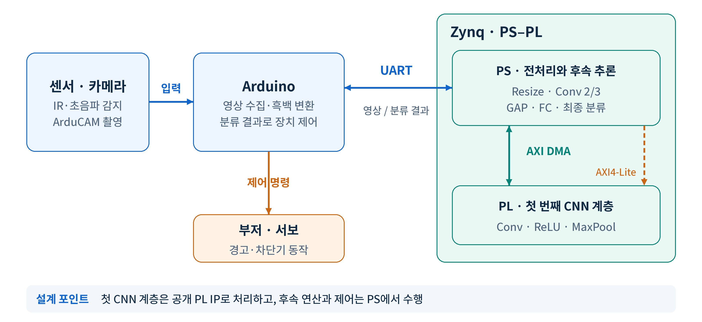
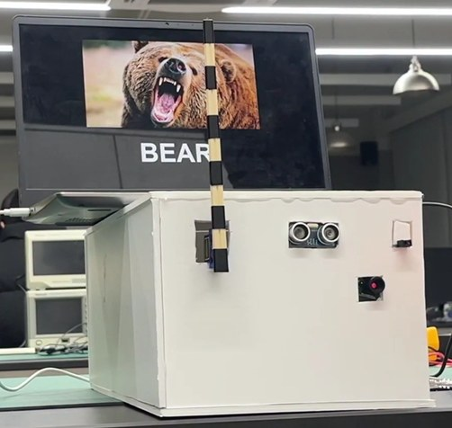

# Zynq 엣지 AI 영상 분류 시스템

IR·초음파 센서가 움직임을 감지하면 카메라 영상을 받아 **곰·사람·배경**을 분류하고, 결과에 따라 부저와 차단기 서보를 동작시키는 이벤트 기반 엣지 AI 시스템입니다.
Arduino가 센서·카메라·구동을 맡고, Zynq(Zybo Z7-20)의 PS와 PL이 CNN 추론을 나눠 처리합니다.

| 팀 규모 | 역할 |
|---|---|
| 5인 | PS–PL 데이터 전송·추론 제어 담당 |



## 목차

1. [시스템 구성](#1-시스템-구성)
2. [문제와 원인 → 해결 과정 → 결과](#2-문제와-원인--해결-과정--결과)
   - [2.1 학습 모델과 FPGA 합성곱의 연산 규칙 차이](#21-학습-모델과-fpga-합성곱의-연산-규칙-차이)
   - [2.2 17.1MB까지 커진 가중치 헤더: GAP](#22-171mb까지-커진-가중치-헤더-gap)
   - [2.3 추론 중 영상 수신 유실 위험: FreeRTOS Task 분리](#23-추론-중-영상-수신-유실-위험-freertos-task-분리)
3. [통신 신뢰성과 오류 복구](#3-통신-신뢰성과-오류-복구)
4. [동작 시연](#4-동작-시연)

---

## 1. 시스템 구성

```
IR·초음파 감지 → ArduCAM 촬영 → Arduino 흑백 변환 → UART
  → Zynq PS (Resize) → AXI DMA → PL (Conv·ReLU·MaxPool)
  → PS (Conv 2/3 · GAP · FC · 최종 분류) → UART → Arduino → 부저·서보
```

| 구분 | 담당 |
|---|---|
| **Arduino** | 센서 감지, 카메라 영상 수집·흑백 변환, 분류 결과에 따른 부저·서보 제어 |
| **Zynq PS** | 영상 크기 변환, 2·3번째 합성곱, GAP, FC, 최종 분류, 시스템 제어 |
| **Zynq PL** | 연산량이 가장 큰 첫 번째 Conv·ReLU·MaxPool (공개 가속기 IP를 통합해 사용) |

- **제어와 데이터 경로 분리:** 커널 가중치 같은 제어 정보는 AXI4-Lite 레지스터로, 영상과 Feature Map은 AXI DMA(MM2S·S2MM)로 전송합니다.
- **연산기 재사용:** 가속기는 한 번에 출력 채널 하나를 만듭니다. 연산기를 복제하지 않고, PS가 AXI4-Lite로 3×3 커널을 바꿔 가며 같은 연산기를 16번 실행해 16채널 Feature Map을 만듭니다.
- **모델:** 128×128 흑백 입력, 합성곱 블록 3개 + GAP + FC, 3클래스(배경·곰·사람). 클래스당 약 400\~500장으로 학습했습니다.

---

## 2. 문제와 원인 → 해결 과정 → 결과

### 2.1 학습 모델과 FPGA 합성곱의 연산 규칙 차이

**문제와 원인**
- PL 연산기는 패딩 없는 3×3 합성곱을 고정소수점으로 계산합니다. 일반적인 학습 설정(패딩, 부동소수점)으로 만든 모델을 그대로 올리면 HW 출력이 학습 때와 달라집니다.

**해결 과정**
- 학습 모델의 첫 계층을 HW와 같은 패딩 없는 3×3 합성곱으로 맞췄습니다.
- 입력과 가중치를 **Q12 고정소수점**으로 변환했습니다.
- FPGA의 고정소수점 합성곱을 SW로 재현하는 검증 경로를 만들어, HW 결과를 모델 출력과 대조했습니다.

**결과**
- HW 연산 규칙을 반영한 가중치로 배포했습니다. 가중치는 PS용 고정소수점 C 헤더로, PL 커널은 AXI4-Lite 레지스터에 쓸 수 있는 형식으로 변환했습니다.

### 2.2 17.1MB까지 커진 가중치 헤더: GAP

**문제와 원인**
- 합성곱 결과를 Flatten해 FC에 연결하는 구조라 분류기 입력이 14,400개였고, 가중치 헤더가 17.1MB까지 커졌습니다. 임베디드 보드 메모리에 부담이 되는 크기였습니다.

**해결 과정**
- Flatten 대신 Global Average Pooling을 넣어 분류기 입력을 **14,400 → 64개**로 줄였습니다.
- 두 구조의 정확도, 파일 크기, 보드 적재 가능성을 비교한 뒤 GAP 구조를 채택했습니다.

**결과**
- 가중치 헤더 **17.1MB → 1,513KB (−91%)**
- 트레이드오프: 테스트 정확도는 97%에서 89%로 8%p 낮아졌습니다. 보드에 올릴 수 있는 크기를 우선했습니다.

### 2.3 추론 중 영상 수신 유실 위험: FreeRTOS Task 분리

**문제와 원인**
- 수신과 추론을 한 순차 루프에서 처리하면, 추론하는 동안 UART 수신이 멈춰 새로 들어온 영상 데이터가 지연되거나 유실될 수 있었습니다.

**해결 과정**
- FreeRTOS에서 **수신 Task와 추론 Task를 분리**하고, 수신 Task의 우선순위를 더 높게 두었습니다.
- Task 사이는 Queue와 **이중 버퍼**로 연결해, 한 버퍼를 추론하는 동안 다른 버퍼에 수신이 이어집니다.
- DMA 완료는 Polling 대신 **인터럽트와 세마포어**로 추론 Task를 깨웁니다.
- CPU 캐시와 DMA가 보는 DDR 내용이 어긋나지 않도록, 보내기 전에는 Flush, 받기 전후에는 Invalidate를 수행합니다.

**결과**
- 추론 중에도 수신이 이어지는 구조로 곰·사람·배경 분류와 장치 연동을 시연했습니다.

---

## 3. 통신 신뢰성과 오류 복구

- **프레임 프로토콜:** Arduino–Zynq UART는 시작 정보, Frame ID, 길이, 영상 데이터, CRC로 구성된 프레임 단위로 주고받습니다. CRC가 맞지 않는 프레임은 추론 전에 버립니다.
- **재동기화:** 헤더나 길이가 잘못되면 수신 상태 머신이 다음 정상 프레임의 시작을 다시 찾습니다. 시스템을 재시작하지 않고 다음 프레임부터 동작합니다.
- **Timeout·Reset 경로:** 카메라 캡처나 FPGA 응답이 제한 시간 안에 오지 않으면 대기를 해제합니다. DMA가 Busy이거나 완료 인터럽트가 오지 않으면 상태 레지스터를 확인하고 DMA를 리셋한 뒤 인터럽트 설정을 복구하도록 설계했습니다.

---

## 4. 동작 시연

곰 영상이 감지되면 CNN이 Bear로 분류해 경고음을 내고, 초음파 센서가 가까운 접근을 감지하면 서보로 차단기를 닫습니다. 사람으로 분류되면 정상 상태로 보고 차단기를 다시 엽니다.



**사용 기술:** C · FreeRTOS · Vivado/Vitis · Arduino · Python(모델 학습)
